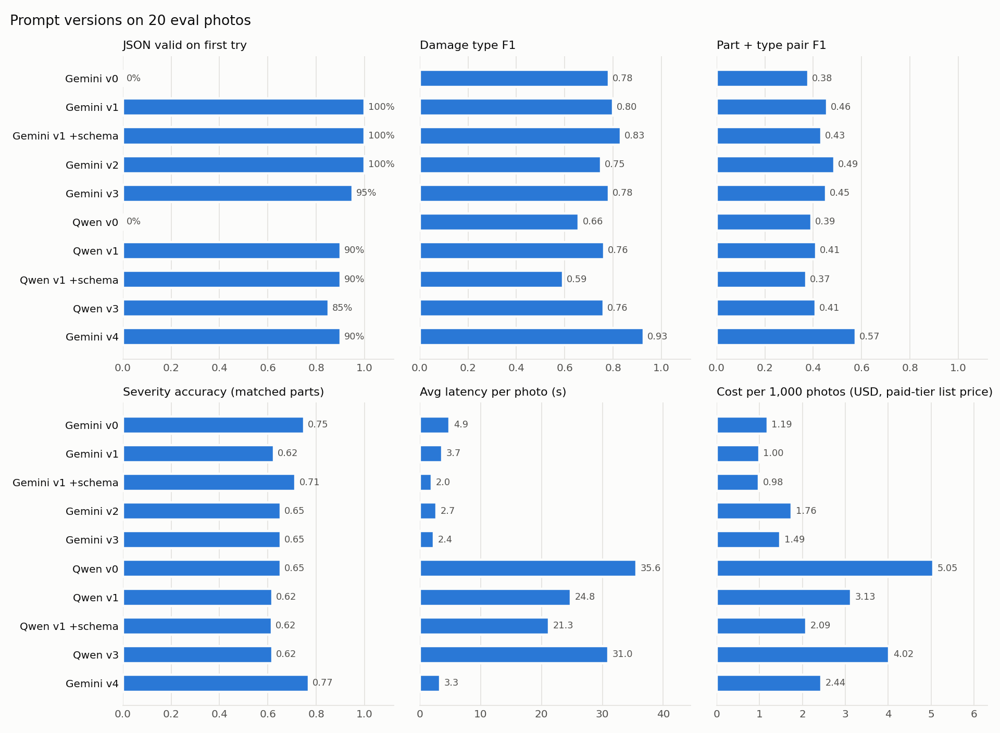
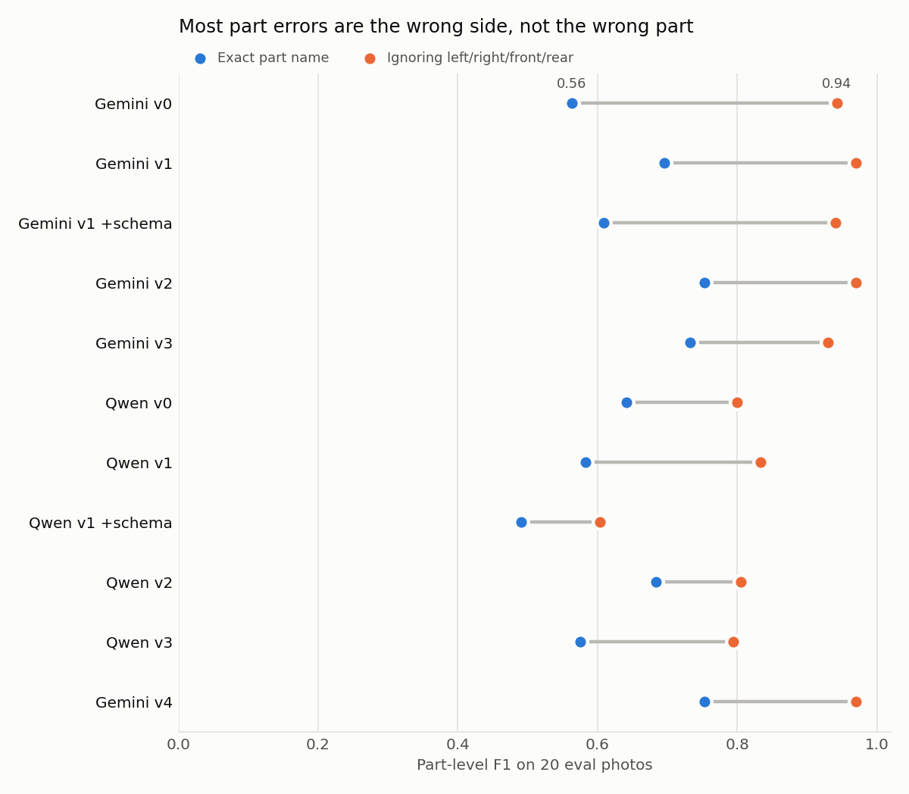

# Vision, Prompting, and Evaluation

*IEEE-style report input for integration into the team's final paper. Prepared for Aarti Panchal to hand to the report editor.*

## Contribution record

This record describes work represented by the checked-in project artifacts. It does not assign an effort percentage or hours because the team has not supplied an agreed allocation.

| Contributor | Work recorded for the report | Percentage or hours |
|---|---|---|
| Aarti Panchal (`@Aarti-panchal01`) | Vision pipeline and byte adapter; Contract A validation and repair flow; prompt versions and examples; Gemini and Qwen/Groq evaluation runs; metrics, charts, bootstrap intervals, and this report input. | Not provided; agree with the team. |
| `@gaganaraj` | To be completed by the contributor and report editor. | Not provided. |
| `@nakshathira200-svg` | To be completed by the contributor and report editor. | Not provided. |
| `@jyothika-aiml` | To be completed by the contributor and report editor. | Not provided. |

Repository access is not evidence of completed work. The report editor should update the other rows from the teammates' actual contributions and agree any percentage or hours with the full team.

## I. Literature review

Vision-based vehicle damage analysis has been studied as a detection and segmentation problem. Wang, Li, and Wu introduced CarDD, a public dataset for car-damage detection and segmentation, and evaluated detection methods on annotated damage instances [1]. This work is directly relevant to the visual domain and data challenges. The present project has a different output objective: it asks a hosted vision-language model (VLM) to produce a bounded, claim-oriented list of visible exterior damage, rather than training a detector or reporting benchmark results on the full CarDD dataset.

Modern VLMs connect image representations with language models so a system can answer questions or follow instructions about an image. BLIP-2 is one example of a two-stage design that bridges frozen image encoders and frozen language models with a lightweight querying transformer [2]. The project uses hosted Gemini and Qwen/Groq services and does not inspect or modify their internal architectures. The relevance of VLM literature is therefore contextual: it motivates testing image-and-language interfaces, but it does not establish that a general-purpose model is reliable for insurance claims.

Prompting provides a way to specify a task without updating model weights. Brown et al. describe in-context few-shot learning through examples supplied in the prompt [3]. In this project, the few-shot strategy provides two worked examples drawn from the dev split. The zero-shot prompt uses instructions without examples. Chain-of-thought prompting has been studied for language-model reasoning [4], and Multimodal Chain-of-Thought extends the approach to image-and-text inputs [5]. Those studies use tasks and model setups different from vehicle-damage claims. Accordingly, the project's v3 prompt is treated as an experimental instruction strategy, not as evidence that an explicit reasoning procedure improves this task. The prompt asks for structured visual checks; the reported evaluation measures the final output, not the correctness of hidden reasoning.

Structured output is important when a model's response is consumed by software. Willard and Louf present guided generation using finite-state machinery and grammars to constrain generated text [6]. The project uses a provider-supported JSON Schema option for one configuration, followed by local Pydantic validation. These are related but not identical mechanisms: the evaluation does not establish formal guarantees for the providers' schema modes. A failed parse or invalid field can trigger a text-only repair request. Self-Refine studies iterative feedback and revision of model outputs [7]; the project's repair loop is narrower because it passes parse or validation errors back to the provider and checks the revised JSON. The cited work motivates investigation, but does not prove that the local repair loop improves damage accuracy.

The project contribution is an integration-oriented experiment: map visual claim evidence into a finite-vocabulary report with explicit vehicle metadata and error handling. The small evaluation is a feasibility check, not a demonstration of insurance readiness, a new detector, or an improvement that generalizes to other fleets or claim populations.

## II. Methodology

### Pipeline and contract

The vision component accepts one to five photos, user-provided vehicle details, and an incident description. It sends image and prompt content to the selected provider, parses the returned JSON, and validates damage entries against the project vocabulary and Pydantic models. Vehicle details are supplied by the user rather than inferred from the image. A successful response is Contract A, containing the claim identifier, vehicle, description, damage list, image-quality flags, model, and prompt strategy. A failed assessment is represented as a `VisionError`.

The implementation supports Gemini and Qwen through Groq, along with a mock provider for tests. The default prompt is `v4_best`; other prompt versions are stored under `prompts/vision/`. If generated text or fields fail parsing or validation, the pipeline can send a text-only repair request, up to two retries. Valid damage reports from multiple images are merged by part and damage type, retaining the more severe observation and the highest confidence. The byte adapter builds image inputs for uploaded photos and converts the assessment result to a Contract A or error dictionary.

### Prompt configurations

The four planned strategies are mapped to these runs:

1. **Zero-shot:** `v1_structured`.
2. **Zero-shot with schema enforcement:** `v1_structured` plus the provider's JSON Schema option.
3. **Few-shot:** `v2_fewshot`, with two dev examples.
4. **Chain-of-thought-oriented:** `v3_cot`.

The `v0_baseline` and `v4_best` prompts are additional experiments, not part of the planned eight-cell matrix. The v4 prompt was refined after reviewing earlier eval errors and therefore was not selected independently of the eval set.

### Data and metrics

The evaluation uses 20 labeled eval images and a separate 10-image dev split. All 20 eval labels are marked `aarti_verified`; none of the 10 dev labels are verified. The two few-shot examples, `dev_03` and `dev_10`, come from the dev split. Models were Gemini `gemini-3.5-flash-lite` and Qwen `qwen/qwen3.8-27b` through Groq. Runs use the repository's cache and output records under `eval/results/`.

Damage-type F1 is the micro-aggregated F1 over each image's distinct damage-type sets. Part exact match is the proportion of images whose predicted set of part names exactly matches the labeled set. First-try JSON validity is the fraction of initial responses that parsed and validated without a repair. Average retries, latency, input/output token counts, and configured per-image cost are also recorded. Bootstrap confidence intervals are percentile 95% intervals from 1,000 image-level resamples with seed 42. A partial run is not treated as a completed comparison.

## III. Results

Seven of the eight planned model/strategy configurations completed a 20-image pass. Qwen v2 stopped after six images when the Groq daily quota was exhausted. Qwen v1 + schema and v3 completed 20-image runs but include provider-error outputs.

| Model / prompt | Images | Damage-type F1 (95% CI) | Part exact (95% CI) | First-try JSON | Avg. retries | Latency (s) | Avg. tokens in/out | Cost (USD/image) |
|---|---:|---:|---:|---:|---:|---:|---:|---:|
| Gemini / v0 baseline | 20 | .781 (.688–.871) | .450 (.250–.700) | 0% | 1.00 | 4.900 | 1,588 / 285 | .001189 |
| Gemini / v1 structured | 20 | .800 (.691–.892) | .650 (.450–.850) | 100% | 0.00 | 3.702 | 1,705 / 194 | .000996 |
| Gemini / v1 + schema | 20 | .831 (.712–.931) | .550 (.350–.750) | 100% | 0.00 | 2.019 | 1,705 / 189 | .000983 |
| Gemini / v2 few-shot | 20 | .750 (.612–.871) | .700 (.500–.900) | 100% | 0.00 | 2.735 | 4,130 / 207 | .001756 |
| Gemini / v3 CoT | 20 | .781 (.656–.893) | .600 (.400–.800) | 95% | 0.05 | 2.350 | 1,961 / 360 | .001489 |
| Gemini / v4 best (extra) | 20 | .925 (.866–.984) | .700 (.500–.900) | 90% | 0.10 | 3.328 | 4,979 / 378 | .002439 |
| Qwen/Groq / v0 baseline (extra) | 20 | .658 (.535–.753) | .300 (.100–.500) | 0% | 1.05 | 35.591 | 2,576 / 747 | .005048 |
| Qwen/Groq / v1 structured | 20 | .763 (.595–.891) | .450 (.250–.651) | 90% | 0.10 | 24.787 | 2,408 / 302 | .003133 |
| Qwen/Groq / v1 + schema | 20 | .593 (.367–.772) | .400 (.200–.650) | 90% | 0.00 | 21.268 | 2,070 / 108 | .002086 |
| Qwen/Groq / v3 CoT | 20 | .761 (.653–.849) | .350 (.150–.550) | 85% | 0.10 | 30.993 | 2,524 / 500 | .004018 |
| Qwen/Groq / v2 few-shot | 6/20, partial | not run yet | not run yet | not run yet | not run yet | not run yet | not run yet | not run yet |

Gemini v4 has the highest observed damage-type F1, .925 (95% CI .866–.984), and part exact match .700 (95% CI .500–.900). It averaged 4,979 input tokens and 378 output tokens per image, 3.328 seconds latency, and $0.002439 per image. On the matched v1 runs, Gemini recorded .800 damage-type F1 and .650 part exact match at 3.702 seconds and $0.000996 per image; Qwen recorded .763 and .450 at 24.787 seconds and $0.003133 per image.

No same-model strategy comparison has non-overlapping bootstrap intervals for damage-type F1 or part exact match. The only separated damage-type intervals among completed configurations are cross-model comparisons involving Gemini v4 and Qwen v0, Qwen v1 + schema, or Qwen v3. These do not isolate prompt effects. No part-exact intervals are disjoint. The observed score differences therefore do not establish a stable prompt improvement.

The v4 eval score is optimistic because v4 was selected after inspecting the same 20 eval images. On the separate, unverified dev labels, v4 damage-type F1 is .667 over 8 images and part exact is 3/8, versus .925 and 14/20 on eval. Side confusion also remains: the per-image records contain 70 expected-to-opposite-side prediction pairs across 10 completed configurations, counting repeated image/configuration cases rather than independent examples.

### Limitations

The scored sample contains only 20 images, much smaller than the planned dataset scale. The dev labels, including both few-shot examples, are unverified. Qwen v2 is incomplete, and two full Qwen configurations include provider errors. Gemini v4 was selected using the eval set. The confidence intervals are wide, and the measurements do not establish generalization, insurance readiness, or a robust ranking between models. Any final paper should keep the 6/20 partial result and these limitations visible.

## References

[1] X. Wang, W. Li, and Z. Wu, “CarDD: A New Dataset for Vision-Based Car Damage Detection,” *IEEE Transactions on Intelligent Transportation Systems*, vol. 24, no. 7, pp. 7202–7214, 2023, doi: [10.1109/TITS.2023.3258480](https://doi.org/10.1109/TITS.2023.3258480).

[2] J. Li, D. Li, S. Savarese, and S. Hoi, “BLIP-2: Bootstrapping Language-Image Pre-training with Frozen Image Encoders and Large Language Models,” arXiv:2301.12597, 2023, doi: [10.48550/arXiv.2301.12597](https://doi.org/10.48550/arXiv.2301.12597).

[3] T. B. Brown *et al*., “Language Models are Few-Shot Learners,” arXiv:2005.14165, 2020, doi: [10.48550/arXiv.2005.14165](https://doi.org/10.48550/arXiv.2005.14165).

[4] J. Wei *et al*., “Chain-of-Thought Prompting Elicits Reasoning in Large Language Models,” arXiv:2201.11903, 2022, doi: [10.48550/arXiv.2201.11903](https://doi.org/10.48550/arXiv.2201.11903).

[5] Z. Zhang, A. Zhang, M. Li, H. Zhao, G. Karypis, and A. Smola, “Multimodal Chain-of-Thought Reasoning in Language Models,” arXiv:2302.00923, 2023, doi: [10.48550/arXiv.2302.00923](https://doi.org/10.48550/arXiv.2302.00923).

[6] B. T. Willard and R. Louf, “Efficient Guided Generation for Large Language Models,” arXiv:2307.09702, 2023, doi: [10.48550/arXiv.2307.09702](https://doi.org/10.48550/arXiv.2307.09702).

[7] A. Madaan *et al*., “Self-Refine: Iterative Refinement with Self-Feedback,” arXiv:2303.17651, 2023, doi: [10.48550/arXiv.2303.17651](https://doi.org/10.48550/arXiv.2303.17651).
