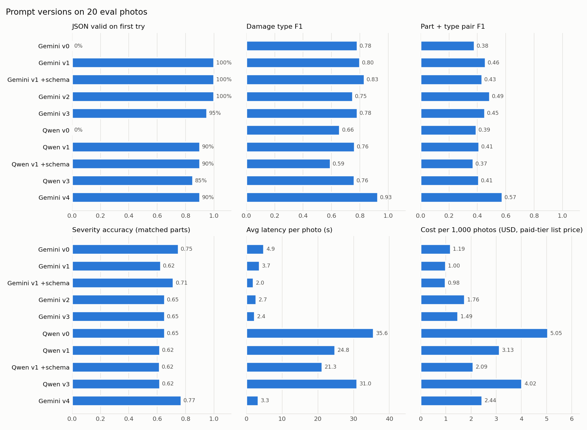
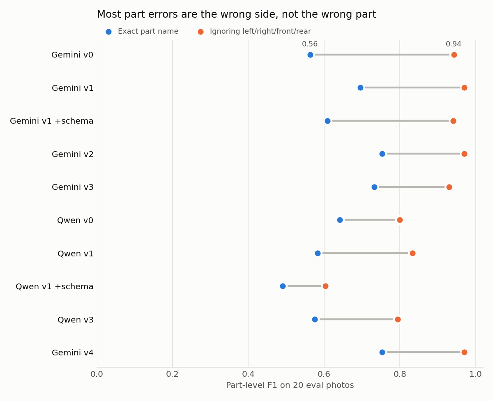

# Role 1: evaluation results

## Setup

The evaluation uses `data/cardd_eval/labels.json` and the images in `data/cardd_eval/images/`. The held-out eval split has 20 images; the dev split has 10. The labels file marks all 20 eval labels `aarti_verified`; all 10 dev labels remain unverified. The few-shot examples (`dev_03`, `dev_10`) come from dev and are excluded from scored eval items.

The evaluated models are Gemini `gemini-3.5-flash-lite` and Qwen `qwen/qwen3.8-27b` through Groq. The planned strategies are `v1_structured` (zero-shot), `v1_structured` with API schema enforcement, `v2_fewshot`, and `v3_cot`, as mapped in `docs/role1/DECISIONS.md`. `v0_baseline` and `v4_best` are additional runs; v4 was written after reviewing earlier eval errors.

The runner records predictions and per-image outcomes under `eval/results/`. Summary metrics are from `summary.csv`; bootstrap intervals and per-image exact-part-set matches are in `summary_with_ci.csv`. A confidence interval resamples images with replacement 1,000 times, with seed 42; intervals are percentile 95% intervals.

## Results

`Part exact` is the fraction of images for which the distinct predicted part set exactly equals the labeled set. Values in parentheses are 95% bootstrap CIs. Input/output tokens and cost are per image.

| Model / prompt | Images | Damage-type F1 (95% CI) | Part exact (95% CI) | First-try JSON | Avg. retries | Latency (s) | Avg. tokens in/out | Cost (USD/image) |
|---|---:|---:|---:|---:|---:|---:|---:|---:|
| Gemini / v0 baseline | 20 | .781 (.688–.871) | .450 (.250–.700) | 0% | 1.00 | 4.900 | 1,588 / 285 | .001189 |
| Gemini / v1 structured | 20 | .800 (.691–.892) | .650 (.450–.850) | 100% | 0.00 | 3.702 | 1,705 / 194 | .000996 |
| Gemini / v1 + schema | 20 | .831 (.712–.931) | .550 (.350–.750) | 100% | 0.00 | 2.019 | 1,705 / 189 | .000983 |
| Gemini / v2 few-shot | 20 | .750 (.612–.871) | .700 (.500–.900) | 100% | 0.00 | 2.735 | 4,130 / 207 | .001756 |
| Gemini / v3 CoT | 20 | .781 (.656–.893) | .600 (.400–.800) | 95% | 0.05 | 2.350 | 1,961 / 360 | .001489 |
| Gemini / v4 best (extra) | 20 | .925 (.866–.984) | .700 (.500–.900) | 90% | 0.10 | 3.328 | 4,979 / 378 | .002439 |
| Qwen/Groq / v0 baseline (extra) | 20 | .658 (.535–.753) | .300 (.100–.500) | 0% | 1.05 | 35.591 | 2,576 / 747 | .005048 |
| Qwen/Groq / v1 structured | 20 | .763 (.595–.891) | .450 (.250–.651) | 90% | 0.10 | 24.787 | 2,408 / 302 | .003133 |
| Qwen/Groq / v1 + schema | 20 | .593 (.367–.772) | .400 (.200–.650) | 90% | 0.00 | 21.268 | 2,070 / 108 | .002086 |
| Qwen/Groq / v3 CoT | 20 | .761 (.653–.849) | .350 (.150–.550) | 85% | 0.10 | 30.993 | 2,524 / 500 | .004018 |
| Qwen/Groq / v2 few-shot | 6/20, partial | not run yet | not run yet | not run yet | not run yet | not run yet | not run yet | not run yet |

The planned eight-way matrix has seven complete configurations. Qwen v2 stopped at `eval_07` when quota was exhausted; six predictions were recorded. It has no summary row, and partial-run tokens/cost are not available in the summary. Qwen v4 is an extra configuration and was not run.

## Metrics and interpretation

- **Damage-type F1:** micro-aggregated F1 over the distinct damage types in each image's expected and predicted damage sets; it does not require the damaged part to be correct.
- **Part exact:** exact match of the distinct part-name sets for each image. An invalid prediction is treated as an empty predicted set, consistent with `eval/metrics.py`.
- **First-try JSON validity:** fraction of images whose initial response parsed and validated without a repair attempt.
- **Average retries:** mean repair attempts per image. Latency and token counts are the per-image means recorded by the runner. Cost is calculated by `eval/run_eval.py` from its configured model rates and recorded token counts.
- **Bootstrap CIs:** image-level resampling, not independent damage-region resampling. With 20 images, one image is 5 percentage points of exact-set accuracy.

No same-model strategy comparison has non-overlapping damage-type or part-exact bootstrap intervals. Across all completed rows, the only non-overlapping damage-type intervals are Gemini v4 versus Qwen v0, Qwen v1 + schema, and Qwen v3. These are cross-model comparisons; they do not isolate a prompt-strategy effect. No part-exact intervals are disjoint. Therefore, the observed score differences are not evidence of a stable improvement across this small sample. Changes no larger than one image are especially not treated as improvements.

Gemini v4 has the highest observed damage-type F1, but it was selected after inspecting these same eval images, so that score is optimistic. The separate Gemini dev check does not confirm the same result: v4 damage-type F1 is .667 on 8 dev images versus .925 on eval, and exact part-set match is 3/8 versus 14/20. The dev labels are unverified, so this check is indicative only.

## Failure modes and operational trade-offs

The per-image files contain 70 expected-to-opposite-side prediction pairs across the 10 complete configurations. This count repeats the same image when it is evaluated under different prompts; it is not 70 independent images. Side errors persist even in v4 and in CoT. In the `dev_05` mock, the image and label show the car's left side, while the incident text says “driver side”; those conflict for an India right-hand-drive car. The visual-side label is not evidence that the model reversed left and right.

Qwen is identified as a 27B model in `docs/role1/DECISIONS.md`; a Gemini parameter count is not reported in this repo. On the matched v1 runs, Qwen averaged 24.787 seconds and $0.003133 per image, versus Gemini's 3.702 seconds and $0.000996. The comparison reflects these recorded runs, not a general model ranking. Qwen v2 has only a partial run and cannot be compared.

## Limitations

- The eval set is only 20 images; the plan discussed a larger set, but that has not been run.
- v4 was selected after inspecting the same eval set used for its score.
- Qwen v2 is incomplete at 6/20; the other three planned Qwen configurations completed 20-image passes. Qwen v1 + schema and v3 include provider-error outputs.
- All 10 dev labels are unverified, including both few-shot examples. The 20 eval labels are marked `aarti_verified`.
- The dev check is small and uses unverified labels. Confidence intervals are wide and overlapping; they do not establish generalization.
- Qwen v4 is an extra, not-run configuration.
